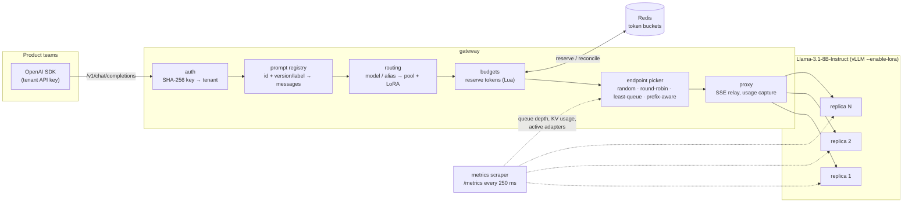
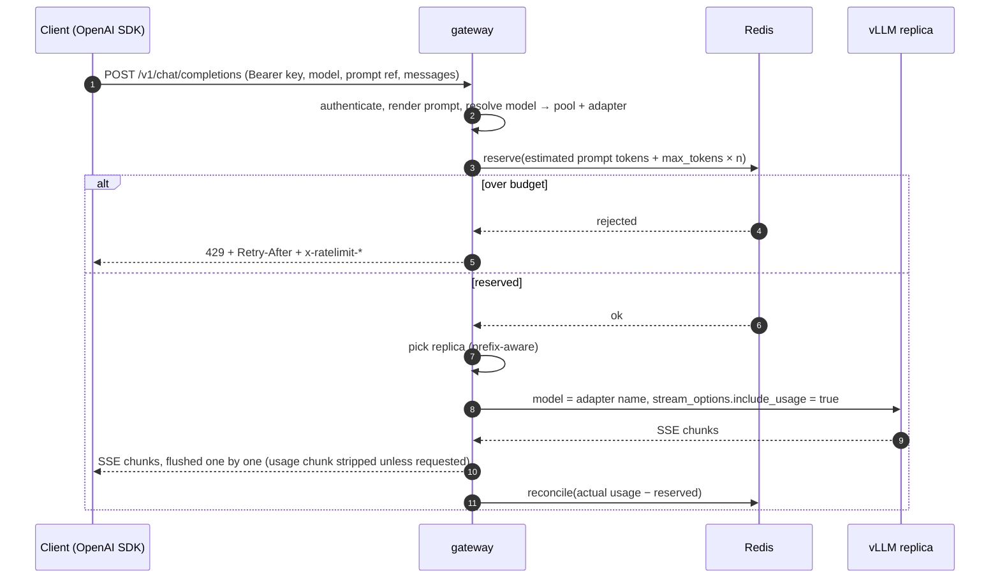
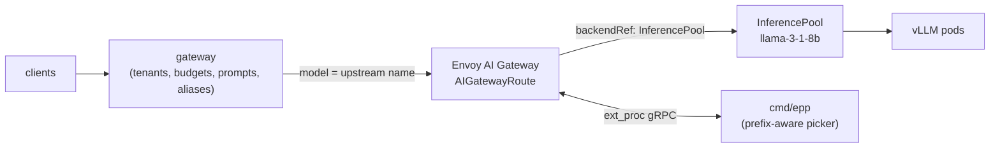

# Multi-Tenant Inference Gateway

Shared model access for product teams. An OpenAI-compatible gateway in Go
that lets several teams call shared Llama pools through the stock OpenAI SDK,
with per-tenant token budgets in Redis, versioned prompts, multi-LoRA
routing, and a prefix-cache-aware endpoint picker. The same picker also ships
as an Envoy `ext_proc` endpoint picker for the
[Gateway API Inference Extension](https://github.com/kubernetes-sigs/gateway-api-inference-extension)
(GIE), so you can run it behind [Envoy AI Gateway](https://aigateway.envoyproxy.io/).

What's been checked and what hasn't:

- **Tested:** the Go code (unit tests, race detector), the budget Lua scripts
  against both miniredis and a real `redis-server`, the OpenAI Python SDK
  against the gateway, and a 200-user benchmark against **simulated** vLLM
  replicas (`cmd/mockvllm`) on a 4-vCPU sandbox.
- **Not tested:** real vLLM, real GPUs, Envoy, Envoy AI Gateway, or any
  Kubernetes cluster. The manifests in `deploy/` were schema-checked against
  the CRDs of the releases named below but never applied to a cluster.

## Contents

- [Components](#components)
- [Architecture](#architecture)
- [Request lifecycle](#request-lifecycle)
- [Token budgets](#token-budgets)
- [Prompt registry](#prompt-registry)
- [Multi-LoRA routing](#multi-lora-routing)
- [Endpoint pickers](#endpoint-pickers)
- [Run it locally](#run-it-locally)
- [Kubernetes with Envoy AI Gateway and the Inference Extension](#kubernetes-with-envoy-ai-gateway-and-the-inference-extension)
- [Benchmark](#benchmark)
- [Observability](#observability)
- [Project layout](#project-layout)
- [Tests](#tests)
- [Limitations](#limitations)

## Components

| Binary | What it does |
|---|---|
| `cmd/gateway` | OpenAI-compatible API (`POST /v1/chat/completions`, `POST /v1/completions`, `GET /v1/models`), streaming and non-streaming. Authenticates tenants, renders versioned prompts, maps models and aliases to a pool and LoRA adapter, enforces token budgets, picks a replica and proxies. |
| `cmd/epp` | Envoy `ext_proc` gRPC server implementing the GIE endpoint-picker protocol with the same pickers. |
| `cmd/mockvllm` | Simulated vLLM replica for development and benchmarking: prefix (KV) cache, sequence slots and a waiting queue, prefill/decode timing, LoRA residency, vLLM-format metrics. |
| `cmd/loadgen` | Benchmark: N concurrent users running multi-turn chats across several tenants; reports TTFT percentiles, throughput, errors and the prefix-cache hit rate read from the servers' counters. |

## Architecture



In Kubernetes the picker can instead run inside Envoy's data path as the
InferencePool's endpoint picker (see [below](#kubernetes-with-envoy-ai-gateway-and-the-inference-extension)).

## Request lifecycle



1. **Authenticate.** `Authorization: Bearer <key>` is hashed with SHA-256 and
   looked up; only digests are stored in the config.
2. **Render the prompt** if the body has a `prompt` reference (see
   [Prompt registry](#prompt-registry)). The response carries `x-prompt-id`
   and `x-prompt-version`.
3. **Resolve the model.** Tenant aliases first, then the public models the
   tenant may use. Unknown or disallowed models both return `404
   model_not_found`, so model names don't leak across tenants.
4. **Reserve budget**: `estimated_prompt_tokens + max_tokens × n`, where the
   estimate is 4 characters per token plus chat framing. With no
   `max_tokens`, `budgets.default_max_tokens` is reserved.
5. **Pick a replica** among the pool's healthy endpoints.
6. **Forward.** The body is decoded only one level deep, so every field the
   gateway doesn't touch (`tools`, `response_format`, vendor extensions, ...)
   is forwarded byte for byte. `model` becomes the upstream name, the
   `prompt` extension is removed, and for streams
   `stream_options.include_usage` is forced on.
7. **Relay.** Non-streaming responses are passed through as-is. Streams are
   relayed event by event with a flush after each one; the final usage-only
   chunk is dropped if the client didn't ask for it.
8. **Reconcile.** The reservation is corrected to the reported usage, or to
   the estimated prompt plus one token per content chunk if the stream ended
   without a usage chunk. Upstream errors refund the whole reservation.

Errors use the OpenAI shape: `{"error": {"message", "type", "param", "code"}}`.

## Token budgets

Each tenant can have `tokens_per_minute` and `tokens_per_day` (0 = no limit).
Both are checked and charged by one Lua script
([`reserve.lua`](internal/budget/reserve.lua)), so concurrent requests and
multiple gateway replicas can't overspend.

- **Per minute: sliding window** approximated from two fixed one-minute
  buckets. With `elapsed` the time into the current minute:
  `used = floor(prev × (1 − elapsed/60s)) + current`. A request is admitted
  if `used + cost ≤ limit`.
- **Per day: fixed UTC day** bucket.
- **Reconcile** ([`reconcile.lua`](internal/budget/reconcile.lua)) adds
  `actual − reserved` to the same buckets the reservation was charged to,
  refunding unused tokens or charging an overrun. Expired buckets are left
  alone and counts never go negative.
- Keys look like `mtig:{tenant}:tpm:<minute>` and `mtig:{tenant}:tpd:<yyyymmdd>`.
  The `{tenant}` hash tag keeps them in one Redis Cluster slot. The current
  time comes from the gateway (keep replicas NTP-synced).

Responses carry `x-ratelimit-limit-tokens`, `x-ratelimit-remaining-tokens`
and `x-ratelimit-reset-tokens` (per-minute), plus
`x-ratelimit-limit-tokens-day` and `x-ratelimit-remaining-tokens-day`. A
rejection is `429 rate_limit_exceeded` with `Retry-After`. That value is
computed from the window arithmetic: how long until the request would fit,
assuming no other traffic. For the daily limit it's the next UTC midnight.
A request that could never fit returns `429 request_too_large` without
`Retry-After`.

**Redis outage.** `budgets.failure_mode: open` (the default) admits requests
unaccounted and counts `gateway_budget_store_errors_total`. `closed` rejects
them with `503 budget_unavailable`. Budget calls time out after
`redis.timeout` (100 ms) and don't retry dials, so an outage adds bounded
latency. Both modes are tested.

## Prompt registry

Prompts live in `prompts/<id>.yaml`. Versions are immutable and numbered;
labels point at versions.

```yaml
id: support-agent
labels:
  production: 2
  staging: 3
versions:
  - version: 2
    params: {temperature: 0.2}        # request defaults; the request wins if it sets them
    messages:
      - role: system
        content: |
          You are a tier-1 support agent ...
          Company: {{ .company }}
          Plan tier: {{ .tier }}
  - version: 3
    messages: [...]
```

A request references it with a `prompt` extension field. With the OpenAI
SDK, pass it via `extra_body`:

```json
{
  "model": "support-bot",
  "prompt": {"id": "support-agent", "label": "production", "variables": {"company": "Acme", "tier": "pro"}},
  "messages": [{"role": "user", "content": "Our bucket returns 403"}]
}
```

- **Resolution:** `version` (`3`, `"3"` or `"v3"`) wins over `label`. With
  neither, the `production` label is used if it exists, otherwise the latest
  version.
- **Rendering:** Go `text/template` with `missingkey=error`, so a missing
  variable is a `400`, never `<no value>` in the prompt. For chat, the
  rendered messages go *in front of* the request's `messages`. For
  `/v1/completions`, a version with a `text` template and a `prompt` object
  renders into the prompt string. A string or array `prompt` there is left
  untouched.
- Unknown prompt, version or label → `404 prompt_not_found`.
- Put variables near the end of a template. Everything before the first
  variable is a prefix shared by every request, which is what the
  prefix-aware picker and vLLM's prefix cache reuse.

The registry is loaded at startup (from a ConfigMap in Kubernetes). There's
no hot reload or Redis-backed store yet.

## Multi-LoRA routing

```yaml
pools:
  - name: llama-3-1-8b
    base_model: meta-llama/Llama-3.1-8B-Instruct     # name vLLM serves the base weights under
    endpoints: [http://10.0.0.7:8000, http://10.0.0.8:8000]   # or dns: <headless-svc>:8000
    adapters: [support-lora-v2, sql-lora-v1, legal-lora-v1]
models:                                               # public names
  - {name: llama-3.1-8b-instruct, pool: llama-3-1-8b}
  - {name: sql-assistant, pool: llama-3-1-8b, adapter: sql-lora-v1}
tenants:
  - id: acme-support
    models: [llama-3.1-8b-instruct]                   # allowed public models ("*" = all)
    aliases:                                          # tenant-private names
      support-bot: {model: llama-3.1-8b-instruct, adapter: support-lora-v2}
```

A request for `support-bot` from `acme-support` resolves to pool
`llama-3-1-8b` with adapter `support-lora-v2`. The body forwarded to vLLM has
`"model": "support-lora-v2"`, which is how vLLM started with
`--enable-lora --lora-modules support-lora-v2=...` selects an adapter. All
replicas of a pool can serve every adapter, so routing to an adapter isn't a
hard filter. Adapter locality is a scoring term (below), because loading an
adapter that isn't resident costs time and, with `--max-loras`, may have to
wait for another adapter to drain.

## Endpoint pickers

All pickers implement one interface (`internal/picker`) and get the pool's
healthy endpoints. An endpoint is unhealthy after 3 consecutive failed
scrapes. If every endpoint is unhealthy, all of them stay candidates.

| Strategy | Choice |
|---|---|
| `random` | uniform |
| `round-robin` | cyclic |
| `least-queue` | lowest load, random tie-break |
| `prefix-aware` | highest score below, after the load guard |

**Load** is `max(in-flight requests this process sent to the endpoint,
vllm:num_requests_running + vllm:num_requests_waiting)`. The first term is
exact and instant. The second, scraped every 250 ms, also covers traffic from
other gateway replicas.

**Prefix-aware scoring.** The prompt is canonicalised (chat messages
serialised in order) and split into 64-character blocks, about one 16-token
vLLM KV block each. Each block is hashed chained to the previous block's
hash, seeded with the upstream model or adapter name. So block *i*'s hash
identifies the whole prefix up to *i*, and different adapters never match
(their KV caches aren't shared). The picker can't see the servers' caches.
It keeps an approximate per-endpoint LRU of the block hashes it has routed
there (`lru_capacity` blocks, sized to the replica's KV cache), inserted
tail-first so eviction trims prompt tails before shared prefixes, like
vLLM's block pool. This is the same approach as the GIE prefix-cache scorer.

For each candidate *e* that passes the guard:

```
score(e) = 3 · prefix(e) + 2 · queue(e) + 1 · (1 − kv(e)) + 1 · lora(e)

prefix(e) = leading request blocks found in e's index / request blocks
queue(e)  = 1 − (load(e) − minLoad) / (max_load_delta + 1)
kv(e)     = vllm:kv_cache_usage_perc (or gpu_cache_usage_perc)
lora(e)   = 1 if the adapter is in vllm:lora_requests_info running/waiting (or base model)
            0.5 if a slot is free or nothing is known yet
            0 if all max_lora slots are taken by other adapters
```

**Load guard.** Only endpoints with `load ≤ minLoad + max_load_delta` (default
8) and `kv ≤ max_kv_utilization` (0.95, ignored if no endpoint passes) are
eligible. A hot prefix therefore stays on one replica until that replica runs
8 requests ahead of the least-loaded one. The overflow then goes to the
next-best replica, which caches the prefix too, so hot prefixes get
replicated rather than overloading one pod. Ties are broken at random. The
weights, block size, guard and LRU size are configurable under
`picker.prefix`.

## Run it locally

Requirements: Go 1.24+ and `redis-server`.

```sh
make dev     # Redis, two mock vLLM replicas (:8001, :8002) and the gateway (:8080, admin :9090)
```

```sh
# Models visible to a tenant
curl -s localhost:8080/v1/models -H 'Authorization: Bearer sk-dev-acme-support'

# Tenant alias -> LoRA adapter, versioned prompt, streaming
curl -sN localhost:8080/v1/chat/completions \
  -H 'Authorization: Bearer sk-dev-acme-support' -H 'Content-Type: application/json' \
  -d '{"model": "support-bot", "stream": true, "max_tokens": 32,
       "prompt": {"id": "support-agent", "label": "production",
                  "variables": {"company": "Acme Cloud", "tier": "pro"}},
       "messages": [{"role": "user", "content": "My bucket returns 403"}]}'

# Gateway metrics
curl -s localhost:9090/metrics | grep ^gateway_
```

With the [OpenAI Python SDK](examples/python/chat_with_prompt.py) (tested
with `openai==3.35.1`):

```sh
pip install -r examples/python/requirements.txt
MTIG_API_KEY=sk-dev-acme-support python examples/python/chat_with_prompt.py
```

```python
client = OpenAI(base_url="http://localhost:8080/v1", api_key="sk-dev-acme-support")
client.chat.completions.create(
    model="support-bot",
    messages=[{"role": "user", "content": "Our bucket returns 403."}],
    extra_body={"prompt": {"id": "support-agent", "label": "production",
                           "variables": {"company": "Acme Cloud", "tier": "enterprise"}}},
)
```

Add a tenant: `go run ./cmd/gateway hash-key <new-key>` prints the digest for
`api_keys`. The sample config is [`config/gateway.yaml`](config/gateway.yaml).
`${VAR}` and `${VAR:-default}` are expanded from the environment.

Other targets: `make build` (binaries in `bin/`), `make check` (gofmt, vet,
race tests), `make bench`, `make docker`.

## Kubernetes with Envoy AI Gateway and the Inference Extension

> **Untested against a live cluster.** The manifests are a starting point.
> The custom resources were validated against the structural schemas of the
> CRDs shipped in the releases below (CEL rules not evaluated), and the
> gateway/picker configs embedded in them are loaded by a unit test. Nothing
> was applied to a cluster, run with real vLLM or put behind Envoy.

Targeted API versions:

| Object | API version | Checked against |
|---|---|---|
| `InferencePool` | `inference.networking.k8s.io/v1` | GIE v1.0.0 and v1.6.2 CRDs |
| `InferenceObjective` | `inference.networking.x-k8s.io/v1alpha2` | GIE v1.0.0 CRD (the API that replaced `InferenceModel`; later releases moved it to llm-d under `llm-d.ai`) |
| `AIGatewayRoute` | `aigateway.envoyproxy.io/v1alpha1` | Envoy AI Gateway v1.2.0 CRD (still served, deprecated there in favour of `v1beta1`, which has the identical schema) |
| ext_proc | `envoy.service.ext_proc.v3`, `FULL_DUPLEX_STREAMED` bodies | `github.com/envoyproxy/go-control-plane/envoy` v1.37.0 |

There are two ways to deploy it.

**1. Standalone gateway** ([`deploy/kubernetes`](deploy/kubernetes)). vLLM
runs `meta-llama/Llama-3.1-8B-Instruct` with `--enable-lora --max-loras=4`
and three adapters behind a headless Service. The gateway discovers the pods
through the Service's DNS records (`dns:` in the pool config, re-resolved
every 10 s), scrapes their `/metrics` and picks the pod itself. Redis holds
the budgets.

```sh
kubectl apply -f deploy/kubernetes/namespace.yaml
kubectl -n inference create secret generic hf-token --from-literal=token=$HF_TOKEN
kubectl -n inference create configmap mtig-prompts --from-file=prompts/
kubectl apply -k deploy/kubernetes     # also needs a `lora-adapters` PVC with the adapter weights
```

**2. Envoy-native picking**
([`deploy/inference-extension`](deploy/inference-extension) +
[`deploy/envoy-ai-gateway`](deploy/envoy-ai-gateway)).



The AIGatewayRoute matches the `x-ai-eg-model` header (which Envoy AI Gateway
extracts from the body) for the base model and every adapter name, and sends
them to the InferencePool. The InferencePool's `endpointPickerRef` points at
the `mtig-epp` Service, so Envoy streams each request to `cmd/epp`. The
picker then:

- buffers the body (the InferencePool is annotated
  `aigateway.envoyproxy.io/processing-body-mode: duplex`, Envoy AI Gateway's
  default);
- rewrites `model` if a public name maps to an adapter;
- picks a pod with the same picker code;
- returns the pod as the `x-gateway-destination-endpoint` header and as
  `envoy.lb` dynamic metadata (`ip:port`), with a `content-length` mutation
  for the rewritten body.

It also honours the `envoy.lb.subset_hint` filter, answers `503`/`404`/`400`
as OpenAI-style immediate responses, passes response headers and bodies back
unchanged, and serves gRPC health on :9003 (`liveness`, `readiness`,
`inference-extension`).

In this topology the multi-tenant gateway sits in front of Envoy. Its pool
has one endpoint, the Envoy Gateway Service, so its own picker is moot.
Upstream requests carry `x-gateway-inference-fairness-id: <tenant>` for GIE
flow control. Alternatively, budgets can move into Envoy, using the route's
`llmRequestCosts` with an Envoy Gateway `BackendTrafficPolicy`. That isn't
shown here.

Differences from the reference endpoint picker:

- `cmd/epp` finds pods through the headless Service, not by watching the
  InferencePool. Keep their selectors identical.
- It doesn't implement flow control or priorities, so `InferenceObjective`s
  are ignored. They're included so you can swap in the reference picker.
- The prefix index is per process, so run one replica, or accept that each
  picker replica learns its own approximate index.

## Benchmark

`make bench` (= [`scripts/bench.sh`](scripts/bench.sh)) runs, for each
picker in turn, 4 **fresh** mock vLLM replicas (cold caches), Redis and the
gateway, then `loadgen`. It prints the table below. One run takes about
2.5 minutes.

> **Simulation, not a GPU measurement.** The replicas are `cmd/mockvllm`
> processes. Cache hits are counted by the mock servers
> (`vllm:prefix_cache_hits_total / vllm:prefix_cache_queries_total`, in
> tokens), and TTFT is measured by the client through the real gateway. But
> the latencies come from the simulation model and parameters below, not
> from vLLM. Hardware: this sandbox, 4 vCPUs (Intel Xeon @ 2.80 GHz), 15 GB
> RAM, no GPU. Gateway, Redis, replicas and load generator all share it.

**Workload** ([`internal/loadgen/scenario.go`](internal/loadgen/scenario.go)):

- 200 concurrent users, each running back-to-back conversations of 3–6
  turns.
- 1–3 s think time between turns; requests stream with `include_usage`.
- 5 s warm-up, then 25 s measured. Requests sent in that window count.
- Seed 1.
- Each conversation picks one of five tenants (weights 3/2/2/1/2):

| Tenant | Model | Adapter | System prompt | max_tokens |
|---|---|---|---|---|
| acme-support | `support-bot` | support-lora-v2 | registry prompt `support-agent` v2, ~3.3 KB | 128 |
| globex-analytics | `sql-assistant` | sql-lora-v1 | inline schema + few-shot, ~4.7 KB | 96 |
| initech-docs | base | none | inline docs preamble, ~3.4 KB | 160 |
| umbrella-legal | `contract-reviewer` | legal-lora-v1 | registry prompt `contract-review` v2, ~1.6 KB | 128 |
| hooli-chat | base | none | ~0.25 KB | 96 |

User turns are 100–600 characters; legal turns include a pasted clause.

**Simulated replica**
([`internal/mockvllm`](internal/mockvllm/server.go), defaults):

| Parameter | Value |
|---|---|
| Tokenisation | 4 chars per token |
| KV block | 16 tokens |
| Prefix cache | LRU of 8192 blocks (131k tokens) |
| Sequence slots | 64 (`--max-num-seqs`), FIFO waiting queue |
| Prefill | 10,000 uncached tokens/s, shared FIFO per replica |
| Decode | 50 tokens/s per sequence |
| Base TTFT | 15 ms |
| LoRA | `--max-loras` 4, 50 ms load penalty |
| Output length | deterministic, ½–1× `max_tokens` |

So TTFT = slot wait + LoRA wait/load + prefill-queue wait + uncached
tokens / 10k/s + 15 ms. Finished sequences leave their prompt + completion
blocks cached, so a conversation's next turn can reuse them.

**Gateway:** `config/bench.yaml`, metrics scraped every 250 ms. Prefix
picker defaults: 64-char blocks, weights 3/2/1/1, `max_load_delta` 8, LRU
8192 blocks per endpoint (matching the mock).

### Results

Run of commit `eb6d46b`, seed 1:

| picker | prefix-cache hit rate | TTFT p50 (ms) | TTFT p95 (ms) | TTFT p99 (ms) | req/s | output tok/s | LoRA loads | busiest replica / mean | errors |
|---|---:|---:|---:|---:|---:|---:|---:|---:|---:|
| random | 83.4% | 37 | 85 | 119 | 52.4 | 4808 | 0 | 1.02 | 0/1309 |
| round-robin | 83.8% | 31 | 70 | 87 | 52.7 | 4837 | 0 | 1.01 | 0/1318 |
| least-queue | 83.8% | 37 | 86 | 118 | 52.3 | 4797 | 0 | 1.02 | 0/1307 |
| prefix-aware | 92.3% | 24 | 57 | 102 | 52.4 | 4815 | 2 | 1.08 | 0/1311 |

The same configuration with seeds 1, 2 and 3 (ranges across the three runs):

| picker | prefix-cache hit rate | TTFT p50 (ms) | TTFT p95 (ms) | TTFT p99 (ms) | busiest replica / mean |
|---|---:|---:|---:|---:|---:|
| random | 83.2–83.7% | 35–37 | 75–85 | 99–119 | 1.02–1.09 |
| round-robin | 83.6–83.9% | 30–31 | 70–71 | 87–91 | 1.00–1.01 |
| least-queue | 83.6–83.8% | 36–37 | 82–86 | 112–118 | 1.02 |
| prefix-aware | 92.1–92.3% | 23–24 | 53–57 | 88–102 | 1.04–1.15 |

Against the best baseline, round-robin, prefix-aware cut p95 TTFT by
19–25% and p50 by 23–26% in these runs. Against random, p95 fell by 29–33%.

What the numbers say about this workload:

- **Cache hits.** The prefix-aware picker raised the server-measured hit
  rate from about 84% to about 92%. Put the other way, uncached prompt
  tokens roughly halved, from about 16% to about 8% of prompt tokens. The
  baselines are already high because every tenant's long system prompt ends
  up cached on every replica after a few requests. What prefix-aware routing
  adds is keeping each conversation's growing history on the replica that
  already holds it. With 4 replicas, a random picker sends the next turn
  to that replica only about one time in four.
- **TTFT.** Less prefill means a shorter shared prefill queue. p50 and p95
  TTFT are lower than every baseline in every run. p99 is not consistently
  better: hot prefixes make prefix-aware the least evenly balanced picker
  (busiest replica up to 1.15× the mean), and that shows in the tail.
- **Throughput** is the same for all pickers. The loop is closed and these
  replicas aren't saturated, so users simply wait less.
- **least-queue** doesn't beat random here. Its signal, requests in flight,
  is dominated by decoding sequences, which says little about the prefill
  queue that sets TTFT in this model.

The absolute numbers depend on the simulation parameters, especially how
much of each prompt is shared, prefill speed, cache size and load. These
results shouldn't be read as a prediction for real GPUs.

### LoRA-constrained variant

`make bench-lora` runs the same workload with `--max-loras 2`, so three
adapters compete for two resident slots per replica (commit `eb6d46b`, seed
1):

| picker | prefix-cache hit rate | TTFT p50 (ms) | TTFT p95 (ms) | TTFT p99 (ms) | req/s | output tok/s | LoRA loads | busiest replica / mean | errors |
|---|---:|---:|---:|---:|---:|---:|---:|---:|---:|
| random | 84.1% | 73 | 12048 | 16932 | 26.8 | 2487 | 114 | 1.11 | 0/671 |
| round-robin | 84.2% | 74 | 13994 | 16748 | 27.8 | 2582 | 110 | 1.04 | 0/695 |
| least-queue | 84.5% | 156 | 12230 | 14846 | 29.0 | 2684 | 101 | 1.37 | 0/724 |
| prefix-aware | 90.9% | 24 | 77 | 259 | 52.3 | 4804 | 3 | 1.09 | 0/1308 |

Here the adapter-blind pickers send every adapter to every replica, which
causes constant adapter swaps. The tail is dominated by the mock's swap
model: a request for a non-resident adapter waits until a resident adapter
has no requests in flight, and admission is FIFO, so later requests queue
behind the swap. Prefix-aware routing keeps tenants, and with them adapters,
on a stable subset of replicas.

Treat this table as an illustration of why adapter affinity matters, not as
a measurement. vLLM's scheduler lets other requests bypass a blocked
adapter, which avoids the head-of-line stall but can starve the swapping
adapter instead, so real behaviour sits between those two extremes and
depends on the vLLM version. Run-to-run variance in this variant is large:
an earlier development run (20 s window) gave prefix-aware a p95 of 163 ms
and a p99 of 5.9 s after a few unlucky adapter placements.

### Reproduce

```sh
make bench                                   # main table (~2.5 min)
make bench-lora                              # LoRA-constrained table (~3 min)
SEED=2 REPLICAS=8 USERS=400 scripts/bench.sh # any parameter via env; MOCK_FLAGS for mockvllm flags
```

Raw JSON results, gateway metrics and logs go to `bench-results/`.

## Observability

Gateway (admin port `/metrics`):

- `gateway_requests_total{tenant,model,code}`
- `gateway_tokens_total{tenant,model,type}`: prompt and completion tokens
- `gateway_time_to_first_token_seconds{model,picker}`
- `gateway_request_duration_seconds{model,stream}`
- `gateway_inflight_requests`
- `gateway_picker_decisions_total{pool,picker,endpoint}`
- `gateway_picker_prefix_match_ratio{pool}`
- `gateway_budget_rejections_total{tenant,reason}`
- `gateway_budget_store_errors_total`
- `gateway_upstream_errors_total{pool,endpoint}`

`/healthz` and `/readyz` are on the same admin port.

Endpoint picker: `epp_requests_total{result}` and
`epp_picker_decisions_total{picker,endpoint}`.

Mock vLLM:

- `vllm:num_requests_running`, `vllm:num_requests_waiting`
- `vllm:kv_cache_usage_perc`
- `vllm:prefix_cache_queries_total`, `vllm:prefix_cache_hits_total`
- `vllm:lora_requests_info`
- `vllm:time_to_first_token_seconds`
- `vllm:prompt_tokens_total`, `vllm:generation_tokens_total`
- `vllm:request_success_total`
- `mockvllm_lora_adapter_loads_total`

## Project layout

```
cmd/
  gateway/   epp/   mockvllm/   loadgen/
internal/
  auth/        API key digests -> tenants
  budget/      Redis token budgets (reserve.lua, reconcile.lua)
  config/      config loading and validation
  endpoint/    replica pools, DNS discovery, vLLM metrics scraping/parsing
  extproc/     Envoy ext_proc endpoint picker (GIE protocol)
  gateway/     HTTP API, proxying, SSE relay, metrics
  loadgen/     benchmark workload and reporting
  mockvllm/    simulated vLLM replica
  openai/      wire-format helpers, token estimate
  picker/      random, round-robin, least-queue, prefix-aware
  prefixhash/  chained block hashing
  prompts/     versioned prompt registry
  routing/     model / alias / LoRA resolution
config/      gateway.yaml (local dev), bench.yaml (benchmark)
prompts/     sample prompt registry
deploy/      kubernetes/, inference-extension/, envoy-ai-gateway/
examples/    python/ (OpenAI SDK)
scripts/     bench.sh, dev.sh
```

## Tests

`go test -race ./...` (CI also runs gofmt, vet and build). Coverage
includes:

- budget Lua logic with miniredis: limits, sliding-window decay,
  Retry-After, refunds and overruns, expiry, fail-open/closed. The same
  scripts also run against a real Redis when `MTIG_TEST_REDIS_ADDR` is set,
  as it is in CI and was in this sandbox.
- prompt version and label resolution and strict rendering.
- model, alias and LoRA resolution.
- every picker, including prefix affinity, spreading, the load and KV
  guards, LoRA affinity and LRU eviction order.
- vLLM metrics parsing (v0 and v1 names, multiple `lora_requests_info`
  series).
- DNS discovery.
- auth.
- the gateway against an `httptest` upstream: field pass-through, LoRA
  rewrite, prompt rendering, per-chunk flushing, usage stripping and
  reconciliation, 429 headers, Redis outage modes, upstream errors.
- the ext_proc handler over an in-memory gRPC connection: full-duplex body
  buffering, model rewrite, header and metadata, trailers, subset hint,
  immediate errors, response pass-through.
- the mock server's cache, LoRA and prefill models.
- the configs embedded in the manifests.

Not tested: Envoy or Envoy AI Gateway actually calling `cmd/epp`, any
Kubernetes deployment, the Docker image (no Docker daemon was available),
and real vLLM servers.

## Limitations

- **Simulated backends only.** All performance numbers come from
  `cmd/mockvllm`. The mock ignores, among other things, prefill/decode
  interference, preemption when the KV cache is full and batch-size-dependent
  decode speed.
- **Tokens are estimated** at 4 characters per token for reservations and
  the prefix blocks. Budgets are reconciled to server-reported usage, but a
  request is admitted on the estimate.
- **Prefix index is approximate and per process.** It records what this
  process routed, not what the server actually still has cached. Multiple
  gateway or picker replicas each learn their own index.
- **No retries or failover** to another replica when an upstream connection
  fails. Endpoints leave rotation only after 3 failed metric scrapes.
- **No hot reload** of config or prompts, and no Redis-backed prompt store.
- **`/v1/completions` with token-ID prompts** is rejected. Embeddings and
  the Responses API are not proxied.
- **`cmd/epp`** doesn't watch InferencePools through the Kubernetes API and
  doesn't implement flow control or InferenceObjective priorities. It
  expects full-duplex body mode.
- **Response bodies are not rewritten.** The `model` field in responses is
  the upstream (adapter) name.
- Kubernetes, Envoy AI Gateway and GIE manifests are **untested against a
  live cluster**.

## License

Apache-2.0. See [LICENSE](LICENSE).
