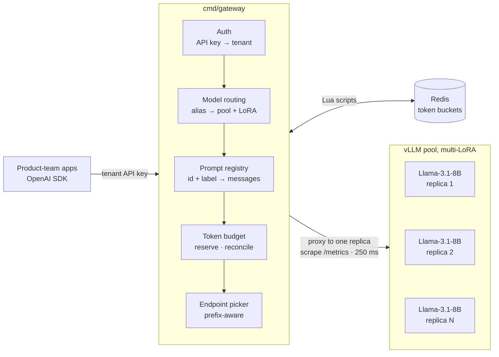
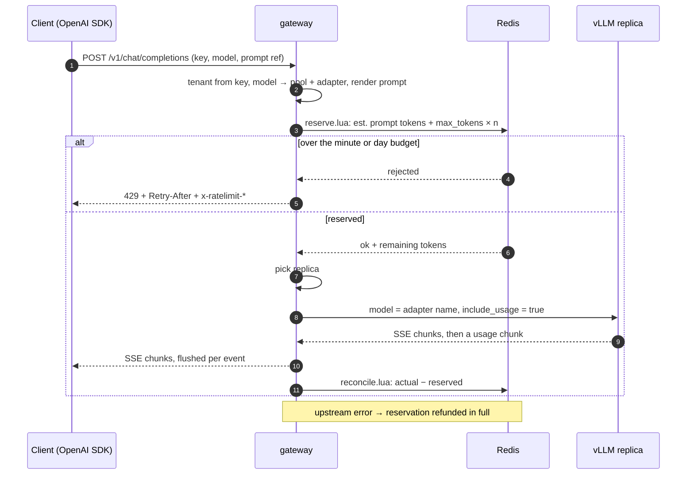
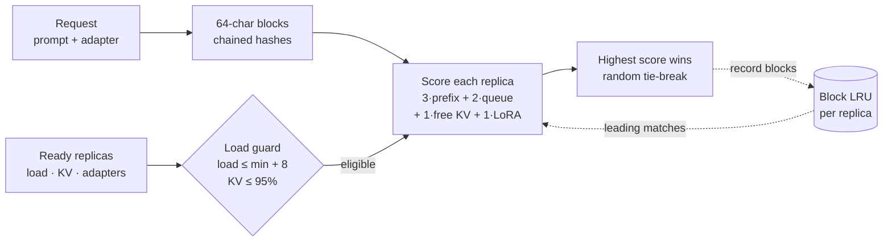
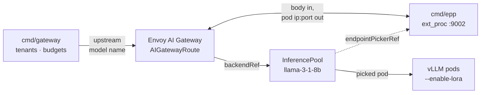

# Multi-Tenant Inference Gateway

An OpenAI-compatible gateway in Go that lets several product teams share Llama pools on vLLM, with
per-tenant token budgets, versioned prompts, multi-LoRA routing and a prefix-cache-aware replica picker.

[](https://github.com/nitishsjsucs/multi-tenant-inference-gateway/actions/workflows/ci.yaml)
[](go.mod)
[](LICENSE)



> [!NOTE]
> Unit-, race- and real-Redis-tested. Not yet run against real vLLM, GPUs, Envoy or Kubernetes; all
> benchmark numbers come from simulated vLLM replicas. [What was tested](docs/limitations.md)

## Highlights

- **Stock OpenAI SDK** — chat and text completions, streamed or not; other fields pass through untouched.
- **Token budgets** — tokens per minute (sliding window) and per day per tenant, reserved atomically in Redis.
- **Versioned prompts** — numbered versions plus labels like `production`, rendered by the gateway.
- **Multi-LoRA routing** — tenant aliases like `support-bot` map to base model + adapter on a shared pool.
- **Prefix-aware picking** — sends each request to the replica likely to hold its prompt in KV cache.
- **Envoy endpoint picker** — `cmd/epp` runs the same picker as an `ext_proc` server for InferencePools.

## Quickstart

Needs Go 1.24+ and `redis-server`. `make dev` runs Redis, two mock vLLM replicas and the gateway until Ctrl-C.

```sh
git clone https://github.com/nitishsjsucs/multi-tenant-inference-gateway && cd multi-tenant-inference-gateway
make dev    # gateway on :8080, admin/metrics on :9090, mock replicas on :8001 and :8002
```

In a second terminal:

```sh
curl -sN localhost:8080/v1/chat/completions \
  -H 'Authorization: Bearer sk-dev-acme-support' -H 'Content-Type: application/json' \
  -d '{"model": "support-bot", "stream": true, "max_tokens": 32,
       "prompt": {"id": "support-agent", "label": "production",
                  "variables": {"company": "Acme Cloud", "tier": "pro"}},
       "messages": [{"role": "user", "content": "My bucket returns 403"}]}'
curl -s localhost:9090/metrics | grep ^gateway_requests_total
```

The mock streams filler tokens; add `-i` to see the `x-prompt-version` and `x-ratelimit-*` headers.
The same call through the OpenAI Python SDK is in [`examples/python`](examples/python/chat_with_prompt.py).
Other targets: `make build`, `make check` (gofmt, vet, race tests), `make bench`, `make docker`.

## How it works

### Request lifecycle



The worst-case cost is reserved atomically, so concurrent requests and gateway replicas can't overspend;
it is then corrected to the reported usage. [Lifecycle](docs/request-lifecycle.md) ·
[budgets](docs/budgets.md) · [prompts](docs/prompts.md)

### Prefix-aware endpoint picking



The picker can't see the servers' caches, so it remembers which block hashes it sent to each replica.
Hashes are seeded with the adapter name because adapters don't share KV cache. [Scoring formula](docs/routing.md#prefix-aware-scoring)

### Kubernetes with Envoy AI Gateway



`deploy/kubernetes` runs the gateway against vLLM pods directly. `deploy/inference-extension` and
`deploy/envoy-ai-gateway` let Envoy ask `cmd/epp` for the pod instead. [Manifests and API versions](docs/kubernetes.md)

## Results

<picture>
  <source media="(prefers-color-scheme: dark)" srcset="docs/images/benchmark-hit-rate-dark.svg">
  
</picture>

<picture>
  <source media="(prefers-color-scheme: dark)" srcset="docs/images/benchmark-ttft-dark.svg">
  
</picture>

| picker | cache hit rate | TTFT p50 | TTFT p95 | TTFT p99 | busiest / mean replica |
|---|---:|---:|---:|---:|---:|
| random | 83.4% | 37 ms | 85 ms | 119 ms | 1.02 |
| round-robin | 83.8% | 31 ms | 70 ms | 87 ms | 1.01 |
| least-queue | 83.8% | 37 ms | 86 ms | 118 ms | 1.02 |
| prefix-aware | **92.3%** | **24 ms** | **57 ms** | 102 ms | 1.08 |

> [!IMPORTANT]
> Simulated: 4 `cmd/mockvllm` replicas, 200 users, 25 s measured, seed 1, on a shared 4-vCPU sandbox
> with no GPU. Latencies come from the mock's timing model, not from real vLLM.

Across seeds 1–3, prefix-aware beat every baseline on hit rate, p50 and p95 (p95 19–25% below round-robin).
p99 is not consistently better: hot prefixes make it the least evenly balanced picker. [Parameters, all tables, reproduce](docs/benchmark.md)

## Example: tenants, aliases and adapters

From [`config/gateway.yaml`](config/gateway.yaml) (`${VAR}` and `${VAR:-default}` are expanded from the environment):

```yaml
pools:
  - name: llama-3-1-8b
    base_model: meta-llama/Llama-3.1-8B-Instruct   # name vLLM serves the base weights under
    endpoints: [http://127.0.0.1:8001, http://127.0.0.1:8002]   # or dns: <headless-svc>:8000
    adapters: [support-lora-v2, sql-lora-v1]
models:                                            # public model names
  - {name: llama-3.1-8b-instruct, pool: llama-3-1-8b}
  - {name: sql-assistant, pool: llama-3-1-8b, adapter: sql-lora-v1}
tenants:
  - id: acme-support
    # sha256("sk-dev-acme-support"); generate with: gateway hash-key <key>
    api_keys: [47c0c7636be2dab927068d6818497303daa92c2ffe25f39c8cd88b9b4326ef5b]
    models: [llama-3.1-8b-instruct]                # allowed public models ("*" = all)
    aliases:                                       # tenant-private names
      support-bot: {model: llama-3.1-8b-instruct, adapter: support-lora-v2}
    tokens_per_minute: 200000
    tokens_per_day: 20000000
```

A `support-bot` request from `acme-support` reaches vLLM as `"model": "support-lora-v2"`.

## Project layout

| Path | What |
|---|---|
| `cmd/gateway`, `internal/gateway` | OpenAI-compatible API, proxying, SSE relay, metrics |
| `cmd/epp`, `internal/extproc` | Envoy `ext_proc` endpoint picker (Inference Extension protocol) |
| `cmd/mockvllm`, `cmd/loadgen` | simulated vLLM replica and benchmark load generator |
| `internal/budget` | Redis token budgets: `reserve.lua`, `reconcile.lua` |
| `internal/picker`, `internal/prefixhash`, `internal/endpoint` | pickers, chained block hashes, replica discovery and metrics |
| `internal/prompts`, `internal/routing`, `internal/auth` | prompt registry, model/alias/LoRA resolution, key digests |
| `config/`, `prompts/`, `examples/` | sample configs, sample prompt registry, OpenAI SDK example |
| `deploy/` | Kubernetes, Inference Extension and Envoy AI Gateway manifests |

## Limitations

- **Simulated backends only:** every performance number comes from `cmd/mockvllm`.
- **Admission uses an estimate** of 4 characters per token; usage is reconciled afterwards.
- **The prefix index is approximate and per process**, not what the server actually caches.
- **No retries or failover** to another replica when an upstream connection fails.
- **No hot reload** of config or prompts.
- **`cmd/epp` is partial:** no InferencePool watch, flow control or InferenceObjective priorities.

Full list: [docs/limitations.md](docs/limitations.md).

## Docs

| Page | Covers |
|---|---|
| [Request lifecycle](docs/request-lifecycle.md) | steps, what gets charged, error codes |
| [Token budgets](docs/budgets.md) | sliding window, Lua scripts, headers, Retry-After, Redis outage modes |
| [Prompt registry](docs/prompts.md) | file format, version and label resolution, rendering |
| [Routing and picking](docs/routing.md) | aliases and LoRA, replica state, pickers, prefix-aware scoring |
| [Kubernetes](docs/kubernetes.md) | both deployment modes, targeted GIE and Envoy AI Gateway versions, `cmd/epp` |
| [Benchmark](docs/benchmark.md) | workload, simulator parameters, all result tables, reproduce |
| [Observability](docs/observability.md) | gateway, picker and mock vLLM metrics |
| [Limitations](docs/limitations.md) | what was and wasn't tested, full limitations |

## License

Apache-2.0. See [LICENSE](LICENSE).
