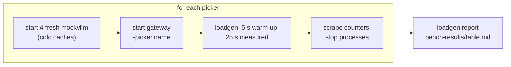
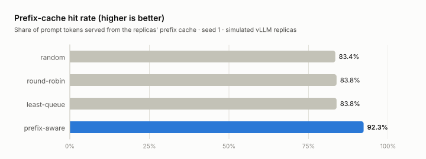
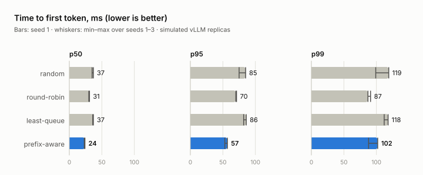

# Benchmark: endpoint pickers against simulated replicas

> [!IMPORTANT]
> Simulation, not a GPU measurement.
> - The replicas are `cmd/mockvllm` processes; latencies come from the simulation model below, not vLLM.
> - Cache hits are counted by the mock servers; TTFT is measured by the client through the real gateway.
> - Hardware: a sandbox VM with 4 vCPUs (Intel Xeon @ 2.80 GHz), 15 GB RAM and no GPU, shared by the
>   gateway, Redis, the replicas and the load generator.

All numbers on this page are in [`results/benchmark.json`](results/benchmark.json) (commit `eb6d46b`).

## How a run works



`make bench` runs [`scripts/bench.sh`](../scripts/bench.sh): Redis once, then the loop above for `random`,
`round-robin`, `least-queue` and `prefix-aware`. A run takes about 2.5 minutes.

## Workload

[`internal/loadgen/scenario.go`](../internal/loadgen/scenario.go): 200 concurrent users run back-to-back
conversations of 3–6 turns, with 1–3 s think time, streaming with `include_usage`. Requests sent during
the 25 s window count. Each conversation picks one of five tenants:

| Tenant | Weight | Model | Adapter | System prompt | `max_tokens` |
|---|---:|---|---|---|---:|
| acme-support | 3 | `support-bot` | support-lora-v2 | registry `support-agent` v2, ~3.4 KB | 128 |
| globex-analytics | 2 | `sql-assistant` | sql-lora-v1 | inline schema + few-shot, ~4.7 KB | 96 |
| initech-docs | 2 | base | none | inline docs preamble, ~3.4 KB | 160 |
| umbrella-legal | 1 | `contract-reviewer` | legal-lora-v1 | registry `contract-review` v2, ~1.6 KB | 128 |
| hooli-chat | 2 | base | none | inline, ~0.2 KB | 96 |

User turns are 12–540 characters; legal first turns paste a contract clause.

## Simulated replica

[`internal/mockvllm`](../internal/mockvllm/server.go) defaults:

| Parameter | Value |
|---|---|
| Tokenisation | 4 characters per token |
| KV block | 16 tokens |
| Prefix cache | LRU of 8192 blocks (131k tokens) |
| Sequence slots | 64 (`--max-num-seqs`), FIFO waiting queue |
| Prefill | 10,000 uncached tokens/s, one shared FIFO per replica |
| Decode | 50 tokens/s per sequence |
| Base TTFT | 15 ms |
| LoRA | `--max-loras` 4, 50 ms load penalty |
| Output length | deterministic, ½–1× `max_tokens` |

TTFT = LoRA wait/load + slot wait + prefill-queue wait + uncached tokens ÷ 10k/s + 15 ms. Finished
sequences leave their prompt and completion blocks cached, so a conversation's next turn can reuse them.

**Gateway:** [`config/bench.yaml`](../config/bench.yaml), metrics scraped every 250 ms, prefix picker
defaults (64-character blocks, weights 3/2/1/1, `max_load_delta` 8) with an LRU of 8192 blocks per
replica to match the mock.

## Metrics

| Column | Definition |
|---|---|
| prefix-cache hit rate | `vllm:prefix_cache_hits_total / vllm:prefix_cache_queries_total` in tokens, summed over replicas |
| TTFT | time to the first streamed token, measured by the load generator |
| busiest replica / mean | requests finished by the busiest replica ÷ the per-replica mean |
| LoRA loads | `mockvllm_lora_adapter_loads_total` |

## Results

<picture>
  <source media="(prefers-color-scheme: dark)" srcset="images/benchmark-hit-rate-dark.svg">
  
</picture>

<picture>
  <source media="(prefers-color-scheme: dark)" srcset="images/benchmark-ttft-dark.svg">
  
</picture>

Seed 1:

| picker | prefix-cache hit rate | TTFT p50 (ms) | TTFT p95 (ms) | TTFT p99 (ms) | req/s | output tok/s | LoRA loads | busiest replica / mean | errors |
|---|---:|---:|---:|---:|---:|---:|---:|---:|---:|
| random | 83.4% | 37 | 85 | 119 | 52.4 | 4808 | 0 | 1.02 | 0/1309 |
| round-robin | 83.8% | 31 | 70 | 87 | 52.7 | 4837 | 0 | 1.01 | 0/1318 |
| least-queue | 83.8% | 37 | 86 | 118 | 52.3 | 4797 | 0 | 1.02 | 0/1307 |
| prefix-aware | 92.3% | 24 | 57 | 102 | 52.4 | 4815 | 2 | 1.08 | 0/1311 |

Seeds 1, 2 and 3 (ranges across the three runs):

| picker | prefix-cache hit rate | TTFT p50 (ms) | TTFT p95 (ms) | TTFT p99 (ms) | busiest replica / mean |
|---|---:|---:|---:|---:|---:|
| random | 83.2–83.7% | 35–37 | 75–85 | 99–119 | 1.02–1.09 |
| round-robin | 83.6–83.9% | 30–31 | 70–71 | 87–91 | 1.00–1.01 |
| least-queue | 83.6–83.8% | 36–37 | 82–86 | 112–118 | 1.02 |
| prefix-aware | 92.1–92.3% | 23–24 | 53–57 | 88–102 | 1.04–1.15 |

Against the best baseline, round-robin, prefix-aware cut p95 TTFT by 19–25% and p50 by 23–26% in these
runs. Against random, p95 fell by 29–33%.

## What the numbers say

| Observation | Why |
|---|---|
| Hit rate rose from about 84% to about 92%; uncached prompt tokens roughly halved (about 16% → 8%) | Every tenant's system prompt ends up cached on every replica anyway. Prefix-aware routing adds keeping each conversation's growing history on the replica that holds it; with 4 replicas, random lands there about one time in four. |
| p50 and p95 TTFT beat every baseline in every run | less prefill means a shorter shared prefill queue |
| p99 is not consistently better | hot prefixes make prefix-aware the least evenly balanced picker (busiest replica up to 1.15× the mean) |
| Throughput is the same for all pickers | the loop is closed and the replicas aren't saturated, so users simply wait less |
| least-queue doesn't beat random | its signal, requests in flight, is dominated by decoding sequences, which says little about the prefill queue that sets TTFT here |

The absolute numbers depend on the simulation parameters: how much of each prompt is shared, prefill
speed, cache size and load. Don't read them as a prediction for real GPUs.

## LoRA-constrained variant

`make bench-lora` runs the same workload with `--max-loras 2`, so three adapters compete for two resident
slots per replica (commit `eb6d46b`, seed 1):

| picker | prefix-cache hit rate | TTFT p50 (ms) | TTFT p95 (ms) | TTFT p99 (ms) | req/s | output tok/s | LoRA loads | busiest replica / mean | errors |
|---|---:|---:|---:|---:|---:|---:|---:|---:|---:|
| random | 84.1% | 73 | 12048 | 16932 | 26.8 | 2487 | 114 | 1.11 | 0/671 |
| round-robin | 84.2% | 74 | 13994 | 16748 | 27.8 | 2582 | 110 | 1.04 | 0/695 |
| least-queue | 84.5% | 156 | 12230 | 14846 | 29.0 | 2684 | 101 | 1.37 | 0/724 |
| prefix-aware | 90.9% | 24 | 77 | 259 | 52.3 | 4804 | 3 | 1.09 | 0/1308 |

The adapter-blind pickers send every adapter to every replica, which causes constant swaps. Prefix-aware
routing keeps tenants, and with them adapters, on a stable subset of replicas.

> [!CAUTION]
> An illustration of why adapter affinity matters, not a measurement.
> - The tail is dominated by the mock's swap model: a request for a non-resident adapter waits until a
>   resident adapter has no requests in flight, and admission is FIFO, so later requests queue behind it.
> - vLLM's scheduler lets other requests bypass a blocked adapter, which avoids that stall but can starve
>   the swapping adapter instead. Real behaviour sits in between and depends on the vLLM version.
> - Run-to-run variance is large: an earlier development run (20 s window) gave prefix-aware a p95 of
>   163 ms and a p99 of 5.9 s after a few unlucky adapter placements.

## Reproduce

Needs Go 1.24+, `redis-server` and `curl`.

```sh
make bench                                   # main table (~2.5 min)
make bench-lora                              # LoRA-constrained table (~3 min)
SEED=2 REPLICAS=8 USERS=400 scripts/bench.sh # any parameter via env; MOCK_FLAGS for mockvllm flags
```

| Variable | Default |
|---|---|
| `REPLICAS`, `USERS`, `SEED` | 4, 200, 1 |
| `WARMUP`, `DURATION` | 5s, 25s |
| `PICKERS` | `random round-robin least-queue prefix-aware` |
| `MAX_LORAS` | 4 |
| `MOCK_FLAGS` | extra `mockvllm` flags, e.g. `-prefill-tps 20000` |
| `OUT` | `bench-results` (raw JSON, gateway metrics, logs, `table.md`) |

To redraw the charts after changing `results/benchmark.json`, run [`charts.py`](charts.py) (needs
matplotlib).
