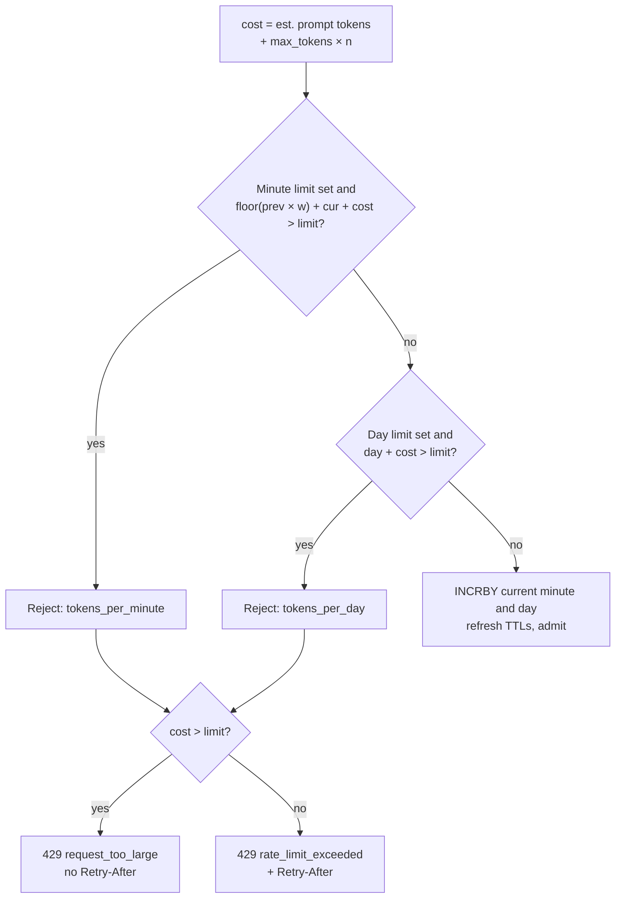

# Token budgets

Each tenant can have `tokens_per_minute` and `tokens_per_day` (0 = no limit). The gateway reserves a
request's worst-case cost before forwarding it and corrects the charge when the response ends
([`internal/budget`](../internal/budget)).

## Reserve: one atomic Lua script

[`reserve.lua`](../internal/budget/reserve.lua) checks and charges both limits in one call, so concurrent
requests and several gateway replicas can't overspend.

`w = 1 − elapsed / 60 s`, where `elapsed` is the time into the current minute.

| Limit | Window | Redis key | TTL |
|---|---|---|---|
| `tokens_per_minute` | sliding, from two fixed one-minute buckets: `used = floor(prev × w) + cur` | `<prefix>:{<tenant>}:tpm:<unix minute>` | 125 s |
| `tokens_per_day` | fixed UTC day | `<prefix>:{<tenant>}:tpd:<yyyymmdd>` | 25 h |

- `<prefix>` is `redis.key_prefix` (default `mtig`).
- The `{tenant}` hash tag keeps a tenant's keys in one Redis Cluster slot.
- The current time comes from the gateway, so keep gateway replicas NTP-synced.

## Reconcile

[`reconcile.lua`](../internal/budget/reconcile.lua) adds `actual − reserved` to the same minute and day
buckets the reservation charged. A negative delta refunds unused tokens; a positive one charges an
overrun.

- Buckets that already expired are left alone.
- Counts never go below zero.
- Nothing is sent when `actual == reserved`.
- It runs on a context detached from the client, so a disconnect mid-stream still settles the bill.

What counts as `actual` is listed in [request lifecycle](request-lifecycle.md#what-gets-charged).

## Response headers

| Header | Value |
|---|---|
| `x-ratelimit-limit-tokens` | `tokens_per_minute` |
| `x-ratelimit-remaining-tokens` | minute budget left (after this reservation if admitted) |
| `x-ratelimit-reset-tokens` | time until the minute bucket rolls over; on a minute rejection, the retry delay |
| `x-ratelimit-limit-tokens-day` | `tokens_per_day` |
| `x-ratelimit-remaining-tokens-day` | day budget left |
| `Retry-After` | whole seconds (at least 1), on `429 rate_limit_exceeded` only |

Headers for a limit appear only when that limit is set and Redis answered.

## Retry-After

Computed from the window arithmetic, assuming no other traffic
([`minuteRetryAfter`](../internal/budget/budget.go)):

| Case | Wait |
|---|---|
| Minute limit, current bucket has room once `prev` decays | `60 s × (1 − (limit − cur − cost) / prev) − elapsed` |
| Minute limit, current bucket alone is too full | rest of this minute, then `60 s × (1 − (limit − cost) / cur)` |
| Day limit | until the next UTC midnight |
| `cost > limit` | never fits: `request_too_large`, no `Retry-After` |

## Redis outage

| `budgets.failure_mode` | Behaviour |
|---|---|
| `open` (default) | admit the request unaccounted, count `gateway_budget_store_errors_total`, omit `x-ratelimit-*` |
| `closed` | reject with `503 budget_unavailable` |

Every budget call is bounded by `redis.timeout` (default 100 ms). The client makes one dial attempt
per connection and retries a command at most once inside that deadline, so an outage adds bounded
latency.

## Tests

| Test | Against |
|---|---|
| `internal/budget`: limits, sliding-window decay, Retry-After, too-large, refunds and overruns, expiry, outage modes | miniredis |
| `TestRealRedis`: the same Lua scripts on a real server | `redis-server` when `MTIG_TEST_REDIS_ADDR` is set (CI sets it) |
| `internal/gateway`: 429 headers and body, Redis outage in both modes, refunds on upstream errors | miniredis + `httptest` upstream |
