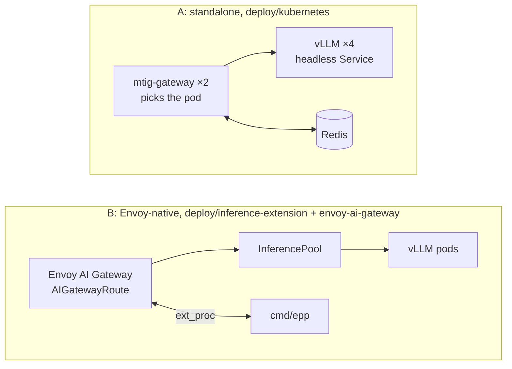
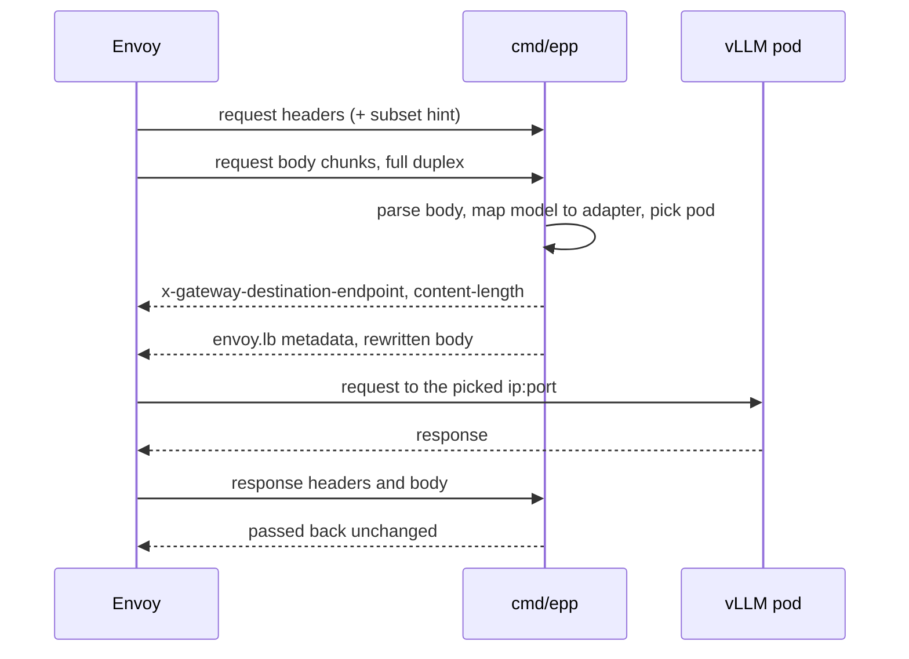

# Kubernetes, Envoy AI Gateway and the Inference Extension

> [!WARNING]
> Untested against a live cluster.
> - Checked: custom resources against the structural schemas of the CRDs below (CEL rules not evaluated),
>   and the configs embedded in the manifests, which a unit test loads.
> - Not done: applying anything to a cluster, running real vLLM, putting `cmd/epp` behind Envoy, building
>   the Docker image (no Docker daemon was available).

## Targeted versions

| Object | API version | Checked against |
|---|---|---|
| `InferencePool` | `inference.networking.k8s.io/v1` | GIE v1.0.0 and v1.6.2 CRDs |
| `InferenceObjective` | `inference.networking.x-k8s.io/v1alpha2` | GIE v1.0.0 CRD (the API that replaced `InferenceModel`; later releases moved it to llm-d under `llm-d.ai`) |
| `AIGatewayRoute` | `aigateway.envoyproxy.io/v1alpha1` | Envoy AI Gateway v1.2.0 CRD (still served there but deprecated in favour of `v1beta1`, which has the identical schema) |
| ext_proc | `envoy.service.ext_proc.v3`, `FULL_DUPLEX_STREAMED` bodies | `github.com/envoyproxy/go-control-plane/envoy` v1.37.0 |
| vLLM | `vllm/vllm-openai:v0.11.0` image | not run; pin the version you validate |

GIE is the [Gateway API Inference Extension](https://github.com/kubernetes-sigs/gateway-api-inference-extension).

## Two ways to deploy



## A: standalone gateway

The gateway finds vLLM pods through the headless Service's DNS records (`dns:` in the pool config,
re-resolved every 10 s), scrapes their `/metrics` and picks the pod itself. Redis holds the budgets.

| Manifest | Contents |
|---|---|
| `vllm.yaml` | 4 replicas of `meta-llama/Llama-3.1-8B-Instruct` with `--enable-prefix-caching --enable-lora --max-loras=4`, three adapters from a `lora-adapters` PVC, headless Service |
| `gateway.yaml` | 2 gateway replicas, config ConfigMap, prompts from the `mtig-prompts` ConfigMap |
| `redis.yaml` | single Redis, no persistence |

```sh
kubectl apply -f deploy/kubernetes/namespace.yaml
kubectl -n inference create secret generic hf-token --from-literal=token=$HF_TOKEN
kubectl -n inference create configmap mtig-prompts --from-file=prompts/
kubectl apply -k deploy/kubernetes     # also needs a `lora-adapters` PVC with the adapter weights
```

## B: Envoy-native picking

Envoy AI Gateway extracts the request's `model` into the `x-ai-eg-model` header. The AIGatewayRoute
matches the base model and each adapter name and sends them to the InferencePool, whose
`endpointPickerRef` points at the `mtig-epp` Service (`failureMode: FailClose`).



| `cmd/epp` behaviour | Detail |
|---|---|
| body mode | buffers the body; the InferencePool is annotated `aigateway.envoyproxy.io/processing-body-mode: duplex` (Envoy AI Gateway's default, required) |
| model rewrite | a public name that maps to an adapter is rewritten to the adapter name |
| picking | same picker code as the gateway |
| result | pod as `x-gateway-destination-endpoint` header and as `envoy.lb` dynamic metadata (`ip:port`) |
| subset hint | honours `envoy.lb.subset_hint` |
| errors | OpenAI-style immediate responses: 400, 404, 413, 503 |
| ports | ext_proc gRPC `:9002`, gRPC health `:9003` (`liveness`, `readiness`, `inference-extension`), metrics `:9090` |

Prerequisites: Envoy Gateway with the Envoy AI Gateway extension and InferencePool support, plus the GIE
CRDs. Then apply the vLLM Deployment and Service from `deploy/kubernetes/vllm.yaml` and everything in
`deploy/inference-extension/` and `deploy/envoy-ai-gateway/`.

### Putting the multi-tenant gateway in front

- Point the gateway's pool at the Envoy Gateway Service; its own picker then has one endpoint and is moot.
  No manifest for this chaining ships in the repo.
- Upstream requests carry `x-gateway-inference-fairness-id: <tenant>` for GIE flow control.
- Budgets could instead move into Envoy via the route's `llmRequestCosts` and an Envoy Gateway
  `BackendTrafficPolicy`; that isn't shown here.

### Differences from the reference endpoint picker

- `cmd/epp` finds pods through the headless Service, not by watching the InferencePool. Keep their
  selectors identical. It needs no RBAC.
- No flow control or priorities, so `InferenceObjective`s are ignored. They're included so you can swap
  in the reference picker.
- The prefix index is per process: run one replica, or accept that each replica learns its own index.
