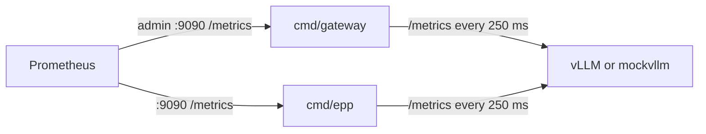

# Observability

The gateway and picker scrape the model servers themselves for routing; Prometheus is optional.
The gateway and `cmd/epp` log JSON to stderr (`-log-level debug|info|warn|error`).

## Gateway (`cmd/gateway`, admin port)

| Metric | Labels | Meaning |
|---|---|---|
| `gateway_requests_total` | `tenant`, `model`, `code` | completed API requests |
| `gateway_tokens_total` | `tenant`, `model`, `type` | prompt and completion tokens |
| `gateway_time_to_first_token_seconds` | `model`, `picker` | arrival to first streamed token |
| `gateway_request_duration_seconds` | `model`, `stream` | end-to-end latency |
| `gateway_inflight_requests` | – | requests being proxied |
| `gateway_picker_decisions_total` | `pool`, `picker`, `endpoint` | picker choices |
| `gateway_picker_prefix_match_ratio` | `pool` | share of prompt blocks the prefix picker expected cached |
| `gateway_budget_rejections_total` | `tenant`, `reason` | 429s by limit |
| `gateway_budget_store_errors_total` | – | failed Redis calls |
| `gateway_upstream_errors_total` | `pool`, `endpoint` | transport errors to model servers |

`/healthz` and `/readyz` are on the same port; `/readyz` fails while a pool has no endpoints.

## Endpoint picker (`cmd/epp`)

| Metric | Labels |
|---|---|
| `epp_requests_total` | `result`: `picked`, `no_endpoints`, `model_not_found`, `bad_request`, `too_large` |
| `epp_picker_decisions_total` | `picker`, `endpoint` |

## Mock vLLM (`cmd/mockvllm`)

vLLM-named metrics, so the same scraper and load generator work against both:

| Metric | Used by |
|---|---|
| `vllm:num_requests_running`, `vllm:num_requests_waiting` | picker load |
| `vllm:kv_cache_usage_perc` | picker KV term and guard |
| `vllm:lora_requests_info` | picker LoRA term |
| `vllm:prefix_cache_queries_total`, `vllm:prefix_cache_hits_total` | benchmark hit rate |
| `vllm:request_success_total` | benchmark balance |
| `vllm:time_to_first_token_seconds`, `vllm:prompt_tokens_total`, `vllm:generation_tokens_total` | inspection |
| `mockvllm_lora_adapter_loads_total` | benchmark LoRA loads (mock only) |
