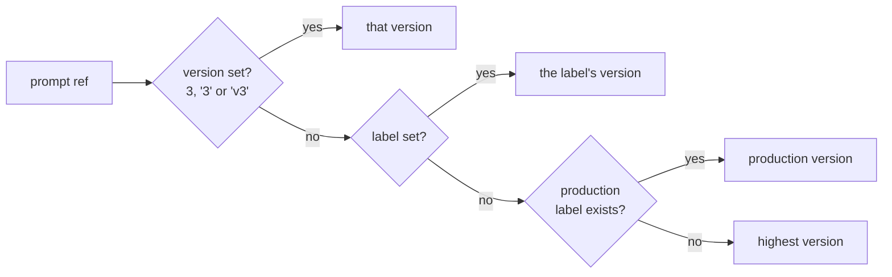

# Prompt registry

Teams keep long system prompts in the gateway instead of every client. Each prompt is a YAML file with
numbered versions and labels that point at versions ([`internal/prompts`](../internal/prompts)).

## File format

`<prompts_dir>/<id>.yaml`, loaded once at startup (a ConfigMap in Kubernetes). Trimmed from
[`prompts/support-agent.yaml`](../prompts/support-agent.yaml):

```yaml
id: support-agent                  # must match the file name
description: Tier-1 customer support agent for a cloud provider.
labels:
  production: 2
  staging: 3
versions:
  - version: 2
    params: {temperature: 0.2}     # request defaults; the request wins if it sets them
    messages:
      - role: system
        content: |
          You are a tier-1 support agent ...
          Company: {{ .company }}
          Plan tier: {{ .tier }}
  - version: 3
    messages: [...]
```

| Field | Rule |
|---|---|
| `id` | required; equals the file name without `.yaml` / `.yml` |
| `labels` | label → version; every label must point at an existing version |
| `versions[].version` | unique positive integer; add a new version instead of editing one |
| `versions[].messages` | chat templates; roles `system`, `developer`, `user`, `assistant` |
| `versions[].text` | completions template |
| `versions[].params` | defaults such as `temperature` or `max_tokens`, applied only when the request omits them |

Unknown fields are rejected, and every version needs `messages` or `text`.

## Referencing a prompt

Requests add a `prompt` extension field. With the OpenAI SDK, pass it through `extra_body`.

```json
{
  "model": "support-bot",
  "prompt": {"id": "support-agent", "label": "production", "variables": {"company": "Acme", "tier": "pro"}},
  "messages": [{"role": "user", "content": "Our bucket returns 403"}]
}
```

## Which version is used



## Rendering

Templates are Go `text/template` with `missingkey=error`, so a missing variable is a `400`, never
`<no value>` in the prompt.

| Request | Template | Result |
|---|---|---|
| chat, `prompt` object | `messages` | rendered messages go in front of the request's `messages`; `prompt` is removed |
| chat, `prompt` not an object | – | `400` |
| completions, `prompt` object | `text` | rendered into the `prompt` string |
| completions, string or array `prompt` | – | left untouched |

| Error | Status |
|---|---|
| unknown id, version or label | `404 prompt_not_found` |
| missing variable, or the version lacks `messages` / `text` for this endpoint | `400` |

Responses carry `x-prompt-id` and `x-prompt-version`.

## Keep the shared prefix long

Put variables near the end of a template. Everything before the first variable is identical across
requests, which is what vLLM's prefix cache and the [prefix-aware picker](routing.md#prefix-aware-scoring)
reuse. `support-agent` v2 keeps its customer context in the last lines for this reason.

## Not supported yet

- Hot reload: restart the gateway to pick up changes.
- A Redis- or API-backed prompt store.
