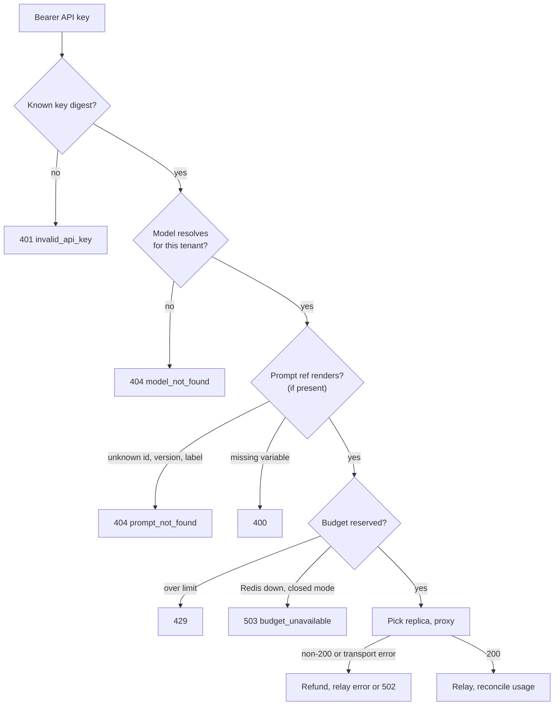

# Request lifecycle

What `cmd/gateway` does with one `POST /v1/chat/completions` or `POST /v1/completions`, in code order
([`internal/gateway/completions.go`](../internal/gateway/completions.go)).

## Steps

| # | Step | What happens |
|---|---|---|
| 1 | Authenticate | `Authorization: Bearer <key>` is hashed with SHA-256 and looked up. The config stores only digests (`gateway hash-key <key>` prints one). |
| 2 | Resolve the model | Tenant aliases first, then public models the tenant may use. Unknown and disallowed models both return `404 model_not_found`, so names don't leak across tenants. `model` is rewritten to the upstream name. See [routing](routing.md). |
| 3 | Render the prompt | Only when the body has a `prompt` object. The response carries `x-prompt-id` and `x-prompt-version`. See [prompts](prompts.md). |
| 4 | Estimate the cost | `estimated prompt tokens + max_tokens × n`. The estimate is 4 characters per token plus chat framing (3 tokens, and 4 per message). `max_completion_tokens` wins over `max_tokens`; with neither, `budgets.default_max_tokens` (1024) is used. |
| 5 | Reserve budget | One Lua script checks and charges both limits. See [budgets](budgets.md). |
| 6 | Pick a replica | Among the pool's healthy endpoints. See [routing](routing.md#pickers). |
| 7 | Forward | The body is decoded one level deep, so fields the gateway doesn't touch (`tools`, `response_format`, vendor extensions) pass byte for byte. The `prompt` extension is removed for chat. For streams, `stream_options.include_usage` is forced on. |
| 8 | Relay | Non-streaming responses pass through as-is. Streams are relayed event by event with a flush after each; the usage-only chunk is dropped unless the client asked for it. |
| 9 | Reconcile | The reservation is corrected to what was used (table below), even if the client disconnected. |

Upstream requests also carry `X-Request-Id` (the client's, or a generated one) and
`X-Gateway-Inference-Fairness-Id: <tenant>` for a downstream Inference Extension picker.

## What gets charged

| Outcome | Tokens charged |
|---|---|
| Response with a `usage` block | `usage.total_tokens` |
| Stream ended without a usage chunk | estimated prompt tokens + 1 per content chunk |
| Non-streaming response without `usage` | estimated prompt tokens |
| Upstream non-200, transport error, no pool or no endpoint | 0 (full refund) |

## Errors

All errors use the OpenAI shape: `{"error": {"message", "type", "param", "code"}}`.

| Status | `code` | When |
|---|---|---|
| 400 | – | bad JSON, missing `model` or `messages`, bad `max_tokens` / `n` / `stream_options`, invalid prompt ref, missing template variable |
| 401 | `invalid_api_key` | missing or unknown key |
| 404 | `model_not_found` | unknown or disallowed model |
| 404 | `prompt_not_found` | unknown prompt id, version or label |
| 404 | `unknown_url` | any other path |
| 429 | `rate_limit_exceeded` | over the minute or day budget; `Retry-After` is set |
| 429 | `request_too_large` | the request could never fit the limit |
| 502 | `upstream_error` | connecting to the model server failed |
| 503 | `budget_unavailable` | Redis unreachable and `budgets.failure_mode: closed` |
| 503 | `no_pool`, `no_endpoints` | nothing to route to |
| upstream's | upstream's | the model server answered non-200; body relayed unchanged |

Limits: request bodies up to 16 MiB, buffered responses up to 64 MiB, whole upstream request bounded by
`upstream_timeout` (default 10 min).

## Other endpoints

| Endpoint | Port | Purpose |
|---|---|---|
| `GET /v1/models` | API (`:8080`) | the tenant's public models plus its aliases |
| `GET /metrics` | admin (`:9090`) | Prometheus metrics, see [observability](observability.md) |
| `GET /healthz` | admin | always 200 |
| `GET /readyz` | admin | 503 while any pool has no endpoints |
