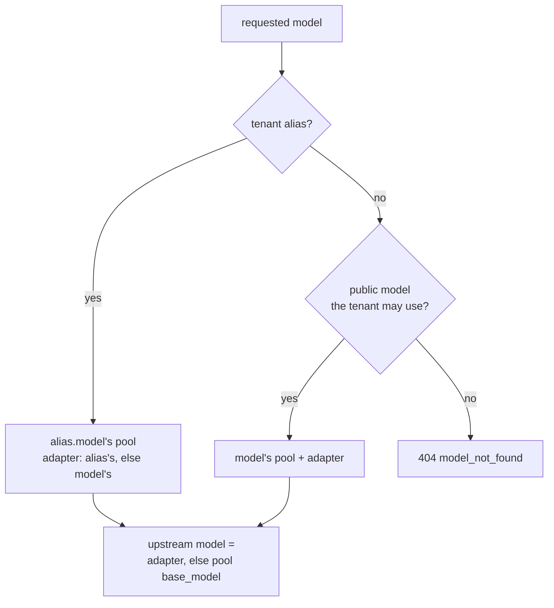

# Model routing and endpoint picking

Two decisions per request: which pool and LoRA adapter a model name means
([`internal/routing`](../internal/routing)), and which replica of that pool serves it
([`internal/picker`](../internal/picker)).

## Model names → pool + adapter



`cmd/epp` resolves without a tenant (authentication happened upstream): every public model resolves,
and so do raw `base_model` and adapter names, since the gateway already sends upstream names.

| Config key | Meaning |
|---|---|
| `pools[].base_model` | the name vLLM serves the base weights under |
| `pools[].endpoints` or `pools[].dns` | static base URLs, or `host:port` of a headless Service re-resolved every `dns_refresh` (10 s); exactly one |
| `pools[].adapters` | LoRA adapters every replica can serve |
| `models[]` | public names: `{name, pool, adapter?}` |
| `tenants[].models` | public models the tenant may call; `"*"` allows all |
| `tenants[].aliases` | tenant-private names: `{model, adapter?}` |

The config is validated at load: unknown pools, models or adapters, duplicate names and duplicate key
digests are errors.

## LoRA on vLLM

- A request for `support-bot` from `acme-support` reaches vLLM as `"model": "support-lora-v2"`.
- That is how vLLM started with `--enable-lora --lora-modules support-lora-v2=...` selects an adapter.
- Every replica can serve every adapter, so the adapter is a scoring term, not a filter.
- Loading a non-resident adapter costs time and, with `--max-loras`, may wait for another to drain.

## Replica state

| Signal | Source |
|---|---|
| load | `max(in-flight requests from this process, vllm:num_requests_running + vllm:num_requests_waiting)` |
| KV use | `vllm:kv_cache_usage_perc` (v1 engine) or `vllm:gpu_cache_usage_perc` (v0) |
| adapters | `vllm:lora_requests_info` labels `running_lora_adapters`, `waiting_lora_adapters`, `max_lora` (newest series wins) |
| health | unhealthy after 3 consecutive failed scrapes; if every replica is unhealthy, all stay candidates |

`/metrics` is scraped every `picker.scrape_interval` (250 ms). The in-flight count is exact and instant;
the scraped count also covers traffic from other gateway replicas.

## Pickers

| `picker.strategy` | Choice |
|---|---|
| `random` | uniform |
| `round-robin` | cyclic |
| `least-queue` | lowest load, random tie-break |
| `prefix-aware` (default) | highest score below, after the load guard |

`gateway -picker <name>` and `epp -picker <name>` override the config.

## Prefix-aware scoring

The picker can't see the servers' KV caches, so it approximates them, like the Inference Extension's
prefix-cache scorer:

1. **Canonicalise** the prompt: chat messages serialised in order as `<|role|>\ncontent\n`.
2. **Split** it into 64-character blocks (about one 16-token vLLM KV block), at most `max_blocks` (256).
   A trailing partial block is ignored.
3. **Hash** each block with FNV-64a, chained to the previous block's hash and seeded with the upstream
   model name. Block *i*'s hash identifies the whole prefix up to *i*, and different adapters never
   match, since their KV caches aren't shared.
4. **Match** against a per-replica LRU of the hashes this process has routed there (`lru_capacity`
   blocks, sized to the replica's KV cache).
5. **Record** the request's blocks in the chosen replica's LRU, inserted tail-first so eviction trims
   prompt tails before shared prefixes, as vLLM's block pool does.

For each replica *e* that passes the guard:

```
score(e) = 3 · prefix(e) + 2 · queue(e) + 1 · (1 − kv(e)) + 1 · lora(e)

prefix(e) = leading request blocks found in e's LRU / request blocks
queue(e)  = 1 − (load(e) − minLoad) / (max_load_delta + 1)
kv(e)     = scraped KV-cache utilisation
lora(e)   = 1    adapter running or waiting on e (or base model)
            0.5  a free adapter slot, or nothing scraped yet
            0    all max_lora slots held by other adapters
```

**Load guard.**

- Only replicas with `load ≤ minLoad + max_load_delta` and `kv ≤ max_kv_utilization` are eligible.
  The KV condition is dropped if no replica passes it.
- A hot prefix stays on one replica until that replica is more than 8 requests ahead of the least-loaded one.
- The overflow goes to the next-best replica, which caches the prefix too, so hot prefixes get
  replicated instead of overloading one pod.
- Ties are broken at random.

**Worked example** (illustrative): a 40-block request for `support-lora-v2`.

| Replica | matched blocks | load | KV | adapter | score |
|---|---:|---:|---:|---|---:|
| A | 30 | 6 | 0.4 | running | 3·0.75 + 2·0.556 + 0.6 + 1 = **4.96** |
| B | 0 | 2 (min) | 0.2 | free slot | 0 + 2·1 + 0.8 + 0.5 = 3.30 |

A wins: its cached prefix outweighs carrying 4 more requests.

## Tuning (`picker.prefix`)

| Key | Default | Notes |
|---|---:|---|
| `block_size` | 64 | characters per block |
| `max_blocks` | 256 | blocks hashed per prompt |
| `lru_capacity` | 31250 | blocks remembered per replica; `config/bench.yaml` uses 8192 to match the mock |
| `max_load_delta` | 8 | load guard |
| `max_kv_utilization` | 0.95 | KV guard |
| `weights` | `{prefix: 3, queue: 2, kv_cache: 1, lora: 1}` | if any weight is set, all four are used as given |

The index lives in process memory: each gateway or `cmd/epp` replica learns its own, and replicas removed
by DNS discovery have theirs dropped.
